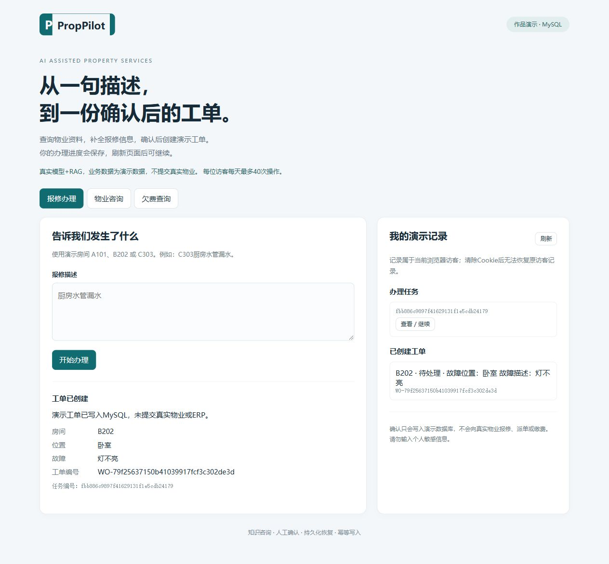
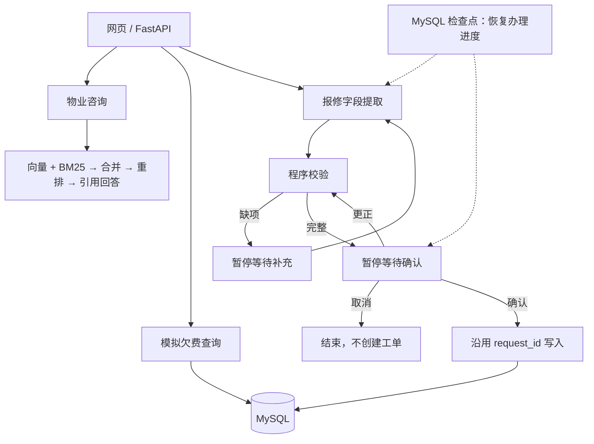

# PropPilot｜可恢复、需确认的物业服务 Agent

Property service agent with human approval, recoverable workflows and idempotent MySQL order creation.

面向物业咨询、欠费查询与报修登记的个人工程作品。重点不是让模型自由执行，而是把模型的字段提取能力放进可校验、需确认、可恢复的业务流程。

**项目边界：模拟业务数据，不接真实物业ERP、不实际派单或缴费；当前未提供公网体验地址。**

## 先看什么

2026-10-16验收：独立Python3.11.17环境从零安装成功，53项测试全部通过（含6项真实MySQL集成测试）；此前live网页已验证咨询引用、报修补充、确认前修改、服务重启恢复及确认写入。Docker和公网部署仍待验证。详见[验证记录](docs/VERIFICATION.md)与[发布计划](docs/ROADMAP.md)。



| 想了解的内容 | 入口 |
|---|---|
| 3分钟演示步骤与验收标准 | [演示脚本](docs/DEMO.md) |
| 架构、代码阅读顺序与设计取舍 | [架构说明](docs/ARCHITECTURE.md) |
| 如何讲清项目，以及常见追问 | [项目讲解手册](docs/INTERVIEW.md) |
| 公开前检查与后续迭代 | [发布清单](docs/RELEASE.md) |
| 本次实际测试与未验证事项 | [验证记录](docs/VERIFICATION.md) |

### 作品看点

- **读写分离**：咨询和欠费查询不创建工单；报修写入必须经过程序校验和用户确认。
- **可恢复流程**：LangGraph中断与MySQL检查点保存待补充、待确认等状态。
- **防重复创建**：沿用请求编号，以数据库唯一约束及事务复用已创建工单；不声称跨系统Exactly-once。
- **可验证边界**：固定演示与真实模型模式明确分开；检索失败不伪装为成功，零欠费不等于查询失败。

### 业务流程



### 运行模式

| 模式 | 模型/检索 | 用途 |
|---|---|---|
| fixture（默认） | 固定提取规则和样例答案，不调用模型与真实RAG | 复现流程、状态、隔离和幂等行为 |
| live | Qwen结构化提取、Chroma+BM25候选合并与rerank | 真实AI链路，需自备密钥并单独验收 |

下面保留完整启动说明。容器配置已提供，但不等于已验证构建或已公开上线。

新网页入口使用 **MySQL存储工单、访客、任务、额度与LangGraph检查点**，无SQLite存储降级。
Chroma负责知识向量，与关系数据库职责分开。旧教学脚本仍保留，旧SQLite和旧MySQL数据不会自动迁移。

这是个人作品演示，不接真实客户物业、派单或缴费。默认fixture模式使用固定样例，不调用模型；live模式调用真实Qwen和已有混合检索/重排。

## 本地启动 Windows 与 PyCharm

1. 使用Python 3.11；新克隆目录先执行 `py -3.11 -m venv .venv-langchain`，解释器选择 `.venv-langchain\Scripts\python.exe`。虚拟环境不随源码发布。
2. 安装已固定版本的依赖：

   ```powershell
   & .\.venv-langchain\Scripts\python.exe -m pip install -r requirements-web.txt
   ```

3. 将 `.env.example` 复制为 `.env`，本地填写MYSQL_PASSWORD；或在PyCharm运行配置中添加该环境变量。
   默认 MYSQL_HOST=127.0.0.1，MYSQL_USER=root，MYSQL_DATABASE=proppilot_showcase。
   不要上传.env、密钥、IDE运行配置。公网环境使用独立低权限应用账号，不使用root。
4. 运行 `run_web.py`。它会显式初始化独立演示数据库；首次本地启动需要创建数据库权限。
5. 打开 `http://127.0.0.1:8000`。若端口被旧PropPilot服务占用，先结束旧服务。

也可以先运行 `python init_web_db.py --create-database`，再运行：

```powershell
python -m uvicorn web_app:app --host 127.0.0.1 --port 8000 --workers 1
```

网页入口是web_app.py，不是旧main.py和控制台app.py。旧接口/菜单仍使用原数据源。

Linux / macOS安装后也可使用同一入口（需Python3.11和可连接的MySQL）：

```sh
python3.11 -m venv .venv-langchain
.venv-langchain/bin/python -m pip install -r requirements-web.txt
cp .env.example .env
# 在.env填写本机MySQL连接信息，保留APP_MODE=fixture
.venv-langchain/bin/python run_web.py
```

## 演示验收

- 物业咨询：“换车牌需要重新登记吗？”应返回资料引用。
- 欠费：C303显示0；不把查询错误显示为无欠费。
- 报修输入“厨房水管漏水”→补充“C303”→等待确认，此时没有工单。
- 确认后记录MySQL工单编号；再次确认返回同一编号。
- 新任务在确认阶段取消，不创建工单。
- 暂停任务后重启服务，保留浏览器Cookie，从记录中查看/继续。
- 无痕浏览器为另一访客，不能访问原访客任务或工单。

固定提取器只识别A/B/C房间编号、厨房/卫生间/卧室/客厅/阳台，以及漏水/损坏/无法启动/不亮/堵塞。它用于确定性流程演示，不代表模型理解能力。

## 切换真实模型与RAG

在.env配置 `APP_MODE=live`、`DASHSCOPE_API_KEY` 与完整 `RERANK_URL`。
真实模型仍使用已有CHAT_MODEL/MODEL_BASE_URL配置。运行 `build_index.py` 建立资料索引后重启网页服务。
不要把密钥写入前端。模型检索失败会明确显示失败，不悄悄换成固定样例。
目前咨询是单次带引用问答，报修是多步持久化流程；没有实现SSE、多Agent、MCP或长期聊天记忆。

## 测试与存储

```powershell
python -B -m unittest discover -s tests -v
```

当前47项非MySQL测试使用模拟模型和临时存储等验证业务及兼容接口；`test_web_mysql.py`另有6项真实MySQL测试，无真实模型调用。
只有设置MYSQL_PASSWORD时新增集成测试才执行；未设置时明确skip。
测试创建随机命名 `proppilot_test_` 数据库，结束后仅删除该测试库，不改旧业务库。
MySQL用户需有创建/删除测试数据库权限；部署账号不授予这类权限。
网页持久化表：web_visitors、web_tasks、web_orders、web_usage、demo_fees，以及检查点库创建的checkpoint_*表。
MySQL >=8.0.19；已按本机8.0.40测试。检查点使用社区langgraph-checkpoint-mysql实现，依赖固定。

## 容器与公网部署

项目提供Dockerfile与compose.yaml。设置MYSQL_ROOT_PASSWORD、MYSQL_PASSWORD后：

```powershell
docker compose up --build -d
```

默认只绑定127.0.0.1:8000，数据库不暴露公网端口。通过同机HTTPS反向代理暴露网站，启用COOKIE_SECURE=true。
请将实际域名替换进deploy/Caddyfile，配置域名解析和服务器防火墙后部署。
必须保持 **一个应用worker、一个副本**。RepairService使用进程内锁，当前检查点连接也不支持多worker共享；多实例需另做任务锁与部署设计。
演示默认每访客每天40次、全站每天300次计费操作，数据库持久保存计数（UTC日界）。另有每IP每分钟60次请求限制。
额度不是货币预算：live一次操作可能包含多次模型请求，仍需在模型供应商侧设置预算上限。
访客Cookie有效7天，记录按随机访客隔离；不是实名登录/真实业务权限系统。
备份MySQL卷；保留量可定期由维护任务清理（当前未实现自动清理）。
真实模型在线调用、Docker镜像构建、HTTPS及公网部署均需分别验收；本地通过不代表已经公网在线。

## 请求接口

GET /api/session 创建或恢复HttpOnly访客Cookie；GET /health 检查数据库连接。
POST /api/consult、POST /api/fees；GET /api/tasks、GET /api/orders。
POST /api/tasks 创建；GET /api/tasks/{id} 查看。
POST /api/tasks/{id}/supplement、confirm、cancel、retry 推进任务。
POST /api/tasks/{id}/edit 更正待确认信息，保存后仍需确认。
任务所有权和允许操作由后端检查，不依赖前端按钮。全程不在浏览器保存数据库或模型凭证。

## 贡献与许可

欢迎通过Issue报告问题或提交改进，见[贡献说明](CONTRIBUTING.md)。
代码使用[MIT许可证](LICENSE)；第三方依赖保留各自许可。data/property_guide.txt为项目内编写的模拟指南，不代表任何物业公司的真实规定。
